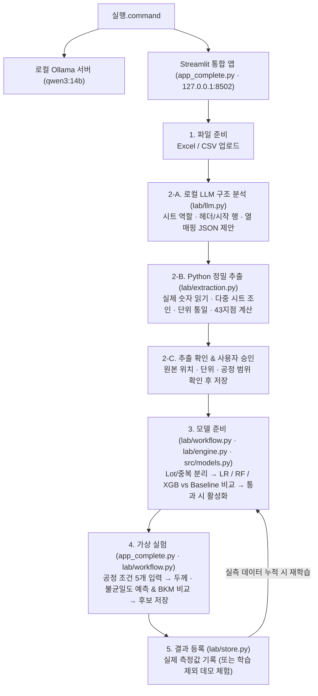

# TikiTaka — 로컬 AI 반도체 박막 공정 가상 실험실

회사마다 양식이 다른 반도체 박막 증착 공정 엑셀을 **로컬 LLM + Python 검증 파이프라인**으로 정리하고, 다중출력 회귀 모델을 학습해 **실제 장비 실험 전에 공정 조건 후보를 비교·예측**할 수 있는 오프라인 로컬 웹 애플리케이션입니다.

> 외부 클라우드 API로 공정 데이터를 전송하지 않도록 로컬 Ollama(`OLLAMA_NO_CLOUD=1`)와 로컬 SQLite/파일 저장소만 사용합니다.

---

## 전체 동작 플로우



---

## 단계별 역할 (무엇이 무엇을 하는가)

### 1. 실행 & 화면 제어
- **`실행.command`**: 로컬 Ollama가 꺼져 있으면 `OLLAMA_NO_CLOUD=1`로 실행하고, Streamlit 통합 앱(`app_complete.py`)을 `http://127.0.0.1:8502`에 띄웁니다.
- **`app_complete.py`**: 상단 5단계(**파일 준비 → 추출 확인 → 모델 준비 → 가상 실험 → 결과 등록**) 워크플로우와 프로젝트/공정 기준 관리 화면을 담당합니다.

### 2. 엑셀 해석 & 데이터 추출 (LLM과 Python의 역할 분리)
- **로컬 LLM (`lab/llm.py`, `qwen3:14b`)**: 시트 미리보기만 보고 *"어느 시트가 조건표/이력표/측정표인지, 어떤 열이 각 입력·출력 항목인지"* **JSON 설계도**만 작성합니다. 숫자를 직접 생성하지 않아 환각을 방지합니다.
- **Python 추출기 (`lab/extraction.py`)**: LLM이 제안한 설계도를 검증한 뒤, 실제 엑셀에서 숫자를 읽고 시트 조인(`Lot + Wafer + Recipe`), 단위 통일(`kW→W`, `Torr/Pa→mTorr`, `slm→sccm`, `min→s`), 43개 측정점 기반 평균 두께 및 반범위 불균일도 계산을 수행합니다.
- **사용자 승인 (`lab/workflow.py`)**: 원본 셀 위치, 단위, 데이터 출처 구분, 공정 범위 확인을 거쳐 승인해야만 학습용 데이터셋으로 저장됩니다.

### 3. 모델 학습 · 검증 · 활성화
- **데이터 분할 (`lab/engine.py`)**: 같은 Lot이나 동일 입출력 기록이 학습/검증/테스트에 섞이지 않도록 묶어서 분리해 데이터 누수를 방지합니다. (최소 40행, 독립 Lot/실험 묶음 7개 이상 필요)
- **모델 비교 (`src/models.py`, `src/evaluation.py`, `lab/workflow.py`)**:
  - `LinearRegression`, `RandomForest`, `XGBoost` 3종을 `StandardScaler` 파이프라인으로 학습하고, 평균값 기준 모델(`Baseline`)과 함께 비교합니다.
  - 검증 세트의 **허용 오차 대비 정규화 MAE**로 최적 모델을 고르며, 허용 기준 충족 및 Baseline 대비 개선을 만족할 때만 사용자가 직접 활성화할 수 있습니다.

### 4. 가상 실험 & BKM 비교
- 활성화된 모델에 공정 조건 5개를 입력하면 예상 **평균 두께**와 **반범위 불균일도**를 계산합니다.
- 데이터셋에 기준 레시피(**BKM**)가 있으면 BKM 대비 두께·불균일도 변화량과 실험 목표 달성 여부를 함께 보여주고, 비교 후보로 저장합니다.

### 5. 결과 등록 & 재학습 루프
- **실제 측정**: 저장한 후보 조건으로 실제 실험한 결과(측정값·Lot·시각)를 등록하면, 이후 모델 준비 단계에서 기존 데이터에 합쳐 재학습할 수 있습니다.
- **데모 체험**: 흐름 체험용 합성 측정값은 `demo_measurement`로 별도 격리 저장되며, 실제 측정 기록과 재학습 데이터에는 포함되지 않습니다.
- **로컬 저장소 (`lab/store.py`)**: 프로젝트별 원본 파일, 추출 CSV, 모델(`.joblib`), 예측 후보, 측정 기록을 `local_data/integrated/` 아래 SQLite와 append-only 파일로 보관합니다.

---

## 입출력 및 공정 범위

> 현재 5입력 모델은 **Si₂H₆ / N₂O / N₂ (N₂O 4,000 sccm · N₂ 3,000 sccm 고정)** 조건 범위를 기준으로 합니다.

| 구분 | 항목 | 학습 · 예측 단위 | 비고 |
|---|---|---|---|
| 입력 | RF 전력 (`power`) | W | `kW` 자동 변환 지원 |
| 입력 | 압력 (`pressure`) | mTorr | `Torr`, `Pa` 자동 변환 지원 |
| 입력 | 온도 (`temperature`) | 원본 단위 유지 | 승인 시 원본 단위(°C / K 등) 확인 |
| 입력 | Si₂H₆ 가스 유량 (`gas`) | sccm | `slm` 자동 변환 지원 |
| 입력 | 증착 시간 (`time`) | s | `min` 자동 변환 지원 |
| 출력 | 평균 두께 (`thickness`) | 원본 단위 유지 | 43지점 `THK1_1_TOP` 평균 또는 요약 열 |
| 출력 | 반범위 불균일도 (`nonuniformity`) | % | `100 × (최대 − 최소) / (2 × 평균)`, 낮을수록 양호 |

---

## 프로젝트 구조

```text
AI_TikiTaka/
├── 설치.command                         # 전용 .venv 생성 및 의존성 설치 (macOS)
├── 실행.command                         # 로컬 Ollama + 통합 앱(8502) 실행 스크립트
├── 통합앱_사용안내.md                   # 5입력 통합 앱(app_complete.py) 상세 사용 가이드
├── 사용안내.md                          # 이전 4입력 앱(app.py) 보관 가이드
├── TikiTaka _ 로컬 AI 박막 공정 가상 실험.pptx
└── AITikiTaka/
    ├── semiconductor_multioutput_regression_spec.md
    └── semiconductor-regression/
        ├── app_complete.py              # [메인] 5입력 통합 Streamlit 웹 앱
        ├── app.py                       # [구버전] 4입력 Streamlit 웹 앱
        ├── train.py / predict.py        # 기존 CLI 학습·예측 진입점
        ├── DEVELOPMENT.md               # 아키텍처 경계, 데이터 정책, 운영 제한사항
        ├── lab/                         # 통합 앱 핵심 엔진
        │   ├── llm.py                   # 로컬 Ollama API 클라이언트 (원격/클라우드 차단)
        │   ├── extraction.py            # 시트 분류·매핑 JSON 검증 및 정밀 추출/조인/단위변환
        │   ├── ingest.py                # 엑셀/CSV 워크북 로더 및 셀 메타데이터 추출
        │   ├── workflow.py              # 5입력 승인·BKM 비교·학습·예측·측정 오케스트레이션
        │   ├── engine.py                # Lot/중복/시간순 데이터 분할 및 평가 유틸
        │   ├── store.py                 # 프로젝트별 SQLite + append-only 아티팩트 저장소
        │   ├── condition_files.py       # 단위 검증 일괄 조건 파일 입출력 유틸
        │   └── constants.py             # 필드/상수 정의
        ├── src/                         # 재사용 ML 코어
        │   ├── models.py                # LinearRegression / RandomForest / XGBoost 정의
        │   ├── evaluation.py            # MAE / RMSE / R² 평가 및 모델 선택
        │   ├── preprocessing.py         # CLI 전처리 파이프라인
        │   ├── data_loader.py           # CLI 데이터 로더
        │   ├── visualization.py         # 결과 시각화
        │   └── config.py                # 기본 설정 상수
        ├── demo_uploads/                # 시연용 합성 업로드 엑셀 (K사 단일표 / L사 다중시트)
        ├── demo_validation/             # K·L사 로컬 LLM 추출 검증 결과 및 정답 CSV
        ├── demo_data/                   # 구버전 4입력 시연용 예제 파일
        ├── scripts/                     # 데이터 감사·단위/챔버/로컬 LLM 검증 스크립트
        ├── tests/                       # 워크플로우·단위·BKM·UI 자동화 테스트 (pytest)
        └── local_data/                  # (Git 제외) 런타임 SQLite, 업로드 원본, 학습 모델 저장
```

---

## 빠른 시작

### 1. 환경 설치 (최초 1회)
- Python 3.9~3.12 환경에서 `설치.command`를 실행합니다. (macOS에서 XGBoost 실행에 `libomp`가 필요하며 스크립트가 자동 설치를 시도합니다.)
- 로컬 LLM 준비:
  ```sh
  brew install ollama
  OLLAMA_NO_CLOUD=1 ollama serve
  # 다른 터미널에서 최초 1회 모델 다운로드
  ollama pull qwen3:14b
  ```

### 2. 앱 실행
- 루트 폴더의 `실행.command`를 실행하고 브라우저에서 **`http://127.0.0.1:8502`** 를 엽니다.
- `AITikiTaka/semiconductor-regression/demo_uploads/`의 `K회사_새공정_업로드데모.xlsx` 또는 `L회사_새공정_업로드데모.xlsx`로 전체 5단계를 바로 체험할 수 있습니다.

### 3. 테스트 실행
```sh
.venv/bin/python -m pytest AITikiTaka/semiconductor-regression/tests -q
.venv/bin/python AITikiTaka/semiconductor-regression/scripts/validate_integrated.py
```

---

## 관련 문서

- [통합앱_사용안내.md](./통합앱_사용안내.md) — 5입력 통합 앱 시연 순서 및 상세 사용법
- [사용안내.md](./사용안내.md) — 기존 4입력 앱(`app.py`) 안내
- [DEVELOPMENT.md](./AITikiTaka/semiconductor-regression/DEVELOPMENT.md) — 설계 경계, 데이터 정책 및 운영 제약
- [semiconductor-regression/README.md](./AITikiTaka/semiconductor-regression/README.md) — 기존 회귀 모델 및 CLI 사용법
